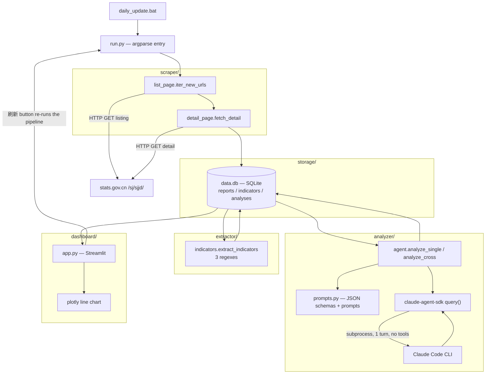
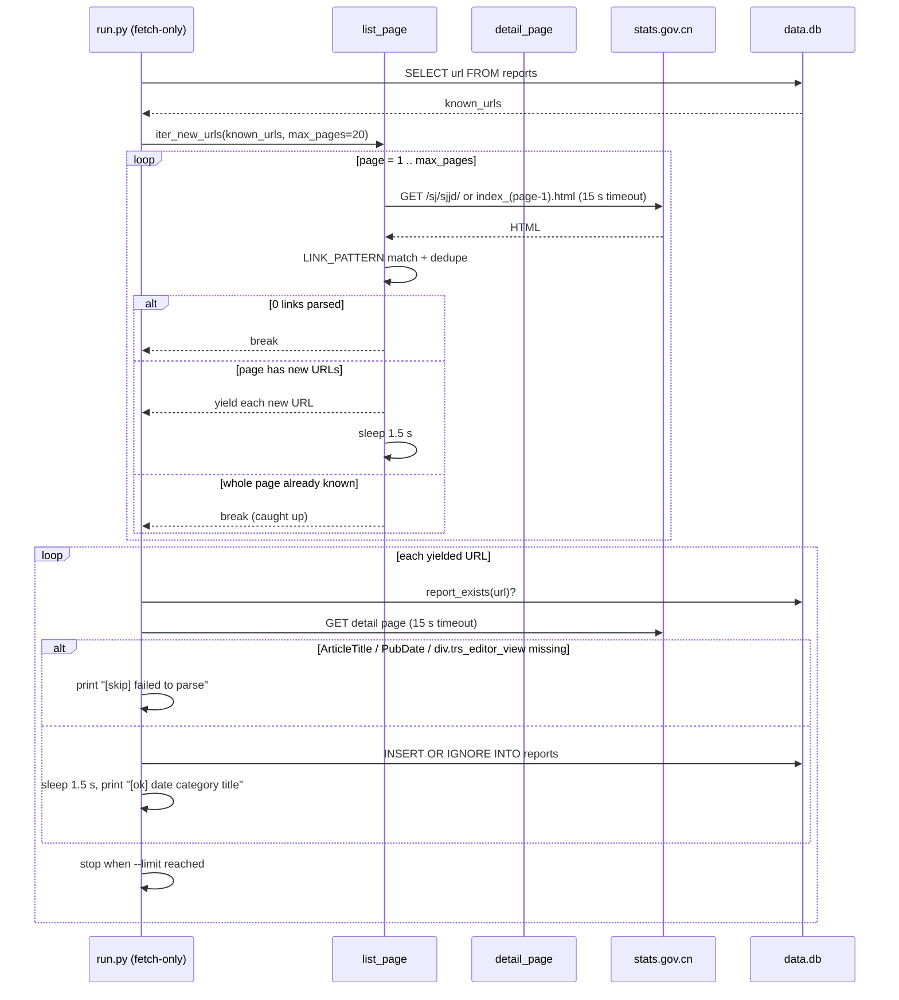
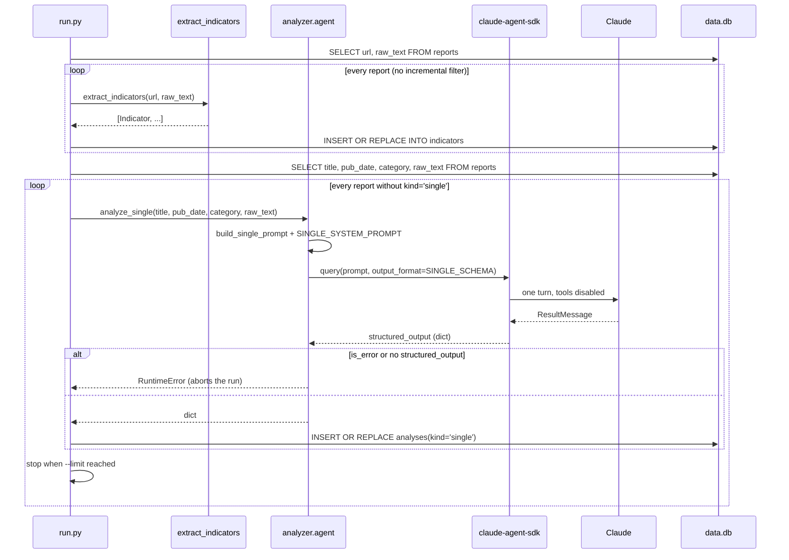
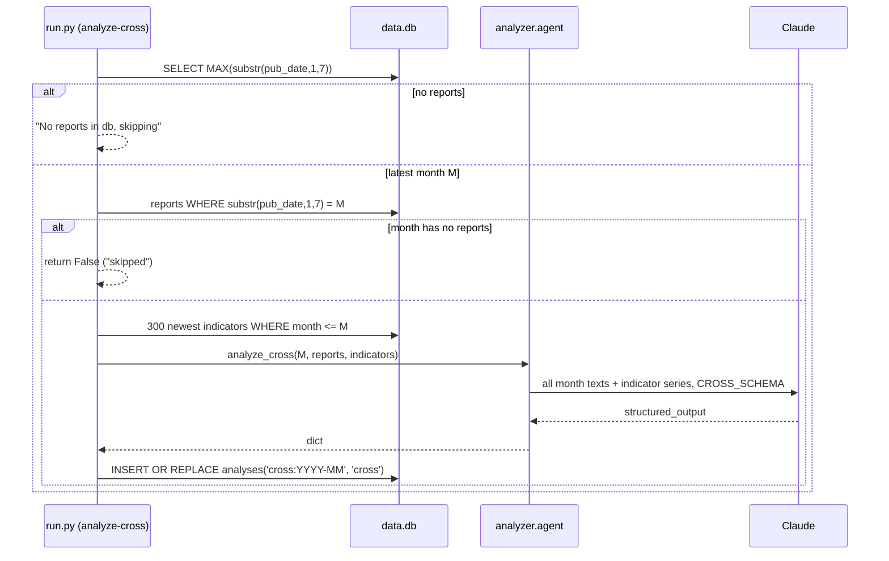
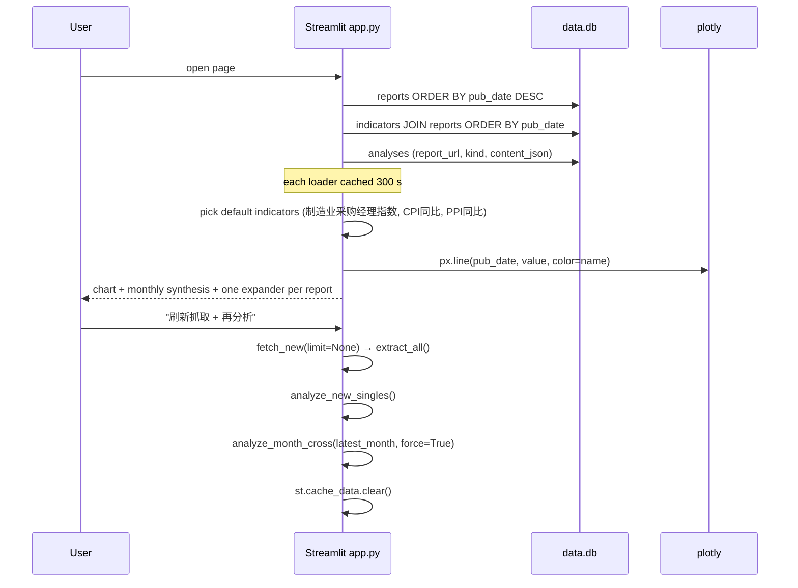
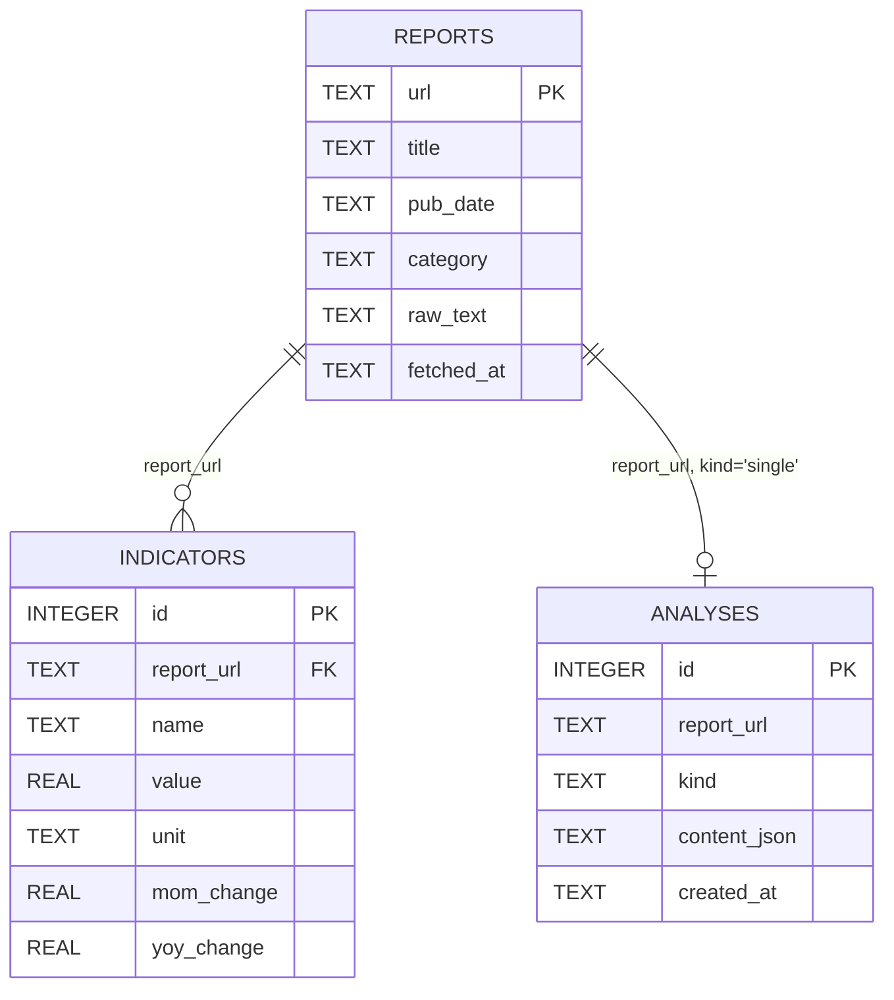
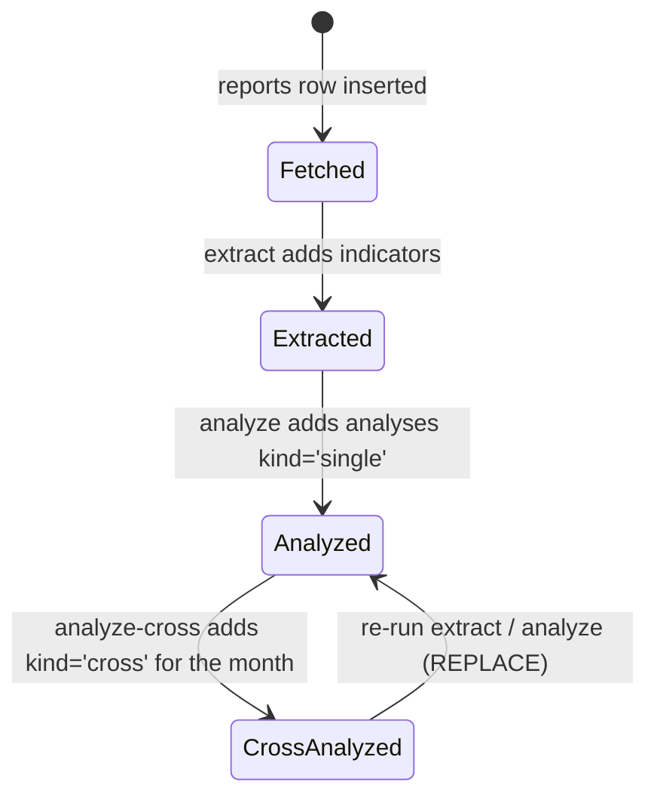

# Macro Monitor — NBS Data-Interpretation Pipeline

[English](README.md) | [简体中文](README.zh-CN.md)

A single-user batch pipeline that crawls China's National Bureau of Statistics "Data
Interpretation" column (<https://www.stats.gov.cn/sj/sjjd/>), keeps each report's text in
SQLite, pulls numeric indicators out of the prose with three regular expressions, and asks
Claude for a structured summary of each report plus a monthly cross-report synthesis. A
Streamlit page reads the same database and renders indicator time series and the analyses.

---

## Overview

The NBS publishes monthly releases as long Chinese articles — PMI, CPI/PPI, investment,
retail sales, industrial output. This repo turns that stream into three queryable tables:

| Table | Holds |
|---|---|
| `reports` | one row per article: URL, title, publish date, guessed category, full body text |
| `indicators` | numeric facts lifted from the text by regex (value, unit, MoM/YoY columns) |
| `analyses` | Claude's structured JSON — one row per report (`kind='single'`) or per month (`kind='cross'`) |

It is built for one analyst on one machine: no server, no authentication, no scheduler daemon.
The database file is committed, so a fresh clone starts with a data snapshot (below), not an
empty database.

The LLM stage is not a plain API call. `analyzer/agent.py` uses `claude-agent-sdk`, which
runs the Claude Code CLI as a subprocess and asks for schema-constrained JSON
(`output_format=` in `analyzer/agent.py:21`). That means the analysis steps need the Claude
Code CLI available and authenticated on the machine; the Python code itself reads no API key.

**Committed snapshot** (`data.db`, 749,568 bytes as of the last commit):

| Metric | Value |
|---|---|
| Reports | 60, published 2026-02-11 → 2026-06-30, fetched 2026-07-03 |
| Indicators | 252 (avg ≈ 4.2 per report), all with `unit = '%'` |
| Analyses | 3, all `kind='single'`; no monthly cross analysis has been stored |
| Largest category | `专题` (13), then `工业` (8), `综合` (6), `CPI/PPI` (6) |

---

## Table of Contents

- [Features](#features)
- [Architecture](#architecture)
- [Key flows](#key-flows)
- [Data model](#data-model)
- [Directory layout](#directory-layout)
- [Getting started](#getting-started)
- [Commands](#commands)
- [CLI](#cli)
- [Configuration](#configuration)
- [Scheduled runs](#scheduled-runs)
- [Troubleshooting](#troubleshooting)
- [Design decisions & limitations](#design-decisions--limitations)
- [FAQ](#faq)
- [License](#license)

---

## Features

**Crawling**
- Walks the listing column page by page, `index_{n}.html` for page *n+1*
  (`scraper/list_page.py:15-18`), up to a configurable page cap (default 20).
- Identifies article links with `^\./(\d{6})/t(\d{8})_(\d+)\.html$`
  (`scraper/list_page.py:12`) and de-duplicates anchors — the listing page emits each
  article link three times, so dedupe is required for a clean page.
- Stops early once a whole page contributes no URL that is missing from `reports`
  (`scraper/list_page.py:50-51`).
- 1.5 s pause between listing pages and between detail fetches (`scraper/list_page.py:52`,
  `run.py:38`); 15 s HTTP timeout on every request.
- Detail parsing is meta-tag based: `ArticleTitle`, `PubDate` (`%Y/%m/%d %H:%M`) and the
  `div.trs_editor_view` body, with `<p>` elements joined by newlines
  (`scraper/detail_page.py:54-64`).

**Categorisation**
- A 27-entry keyword table maps the title to one of 17 labels — `PMI`, `房价`, `CPI/PPI`,
  `CPI`, `PPI`, `投资`, `社零`, `工业`, `就业`, `外贸`, `民生`, `专题`, `综合`, `农业`,
  `能源`, `服务业`, `文化产业` — else `其他` (`scraper/detail_page.py:11-46`). Most specific
  keyword first, first match wins.

**Extraction** — three ordered regexes, no model involved (`extractor/indicators.py`):
1. Index readings with a month-on-month move in percentage points, e.g. "制造业采购经理指数为50.3%，比上月上升0.3个百分点" → value plus signed `mom_change`.
2. The paired CPI/PPI sentence shape "居民消费价格（CPI）环比上涨0.1%，同比上涨0.3%" → up to two rows, `CPI环比` / `CPI同比`.
3. A generic "X 同比 增长 N%" pattern for totals, investment, profit, value-added, revenue and retail sales, with a noisy-prefix stripper (`_clean_name`).

**Analysis**
- Single-report JSON: `core_conclusions`, `risk_flags`, `industry_highlights` and a
  `sentiment` enum of `改善 / 走弱 / 平稳 / 分化` (improving / weakening / stable /
  diverging) (`analyzer/prompts.py:1-29`).
- Monthly cross-report JSON: `overall_assessment`, `divergences` (with
  `indicators_involved`), `convergences`, `inflection_points` and `trend_vs_recent_3m`
  (`analyzer/prompts.py:31-82`).
- Each call is one turn with no tools (`tools=[]`, `max_turns=1`,
  `analyzer/agent.py:17-22`), so the model can only work from the prompt text.

**Storage**
- SQLite at the repo root, schema created on every connection with `CREATE TABLE IF NOT
  EXISTS` — no migration framework (`storage/db.py:6-42`).
- Idempotent writes: `INSERT OR IGNORE` for reports, `INSERT OR REPLACE` for indicators and
  analyses, backed by unique constraints on `(report_url, name)` and `(report_url, kind)`.

**Dashboard**
- One Streamlit page with a sidebar action, an indicator line chart, a monthly synthesis
  block and an expander per report (`dashboard/app.py`).
- Query results cached for 300 s; the cache is cleared after a manual refresh
  (`dashboard/app.py:17,27,43,65`).

---

## Architecture



| Layer | Path | Responsibility |
|---|---|---|
| Entry point | `run.py` | Argparse flags, the four pipeline steps, month selection |
| Domain types | `models.py` | `Report`, `Indicator`, `Analysis` dataclasses (no validation) |
| Scraper | `scraper/list_page.py` | Pagination, link regex, "caught up" detection, 1.5 s delay |
| Scraper | `scraper/detail_page.py` | Meta-tag parsing, body extraction, keyword categorisation |
| Extractor | `extractor/indicators.py` | Three regexes, sign mapping, prefix cleanup, per-report dedupe |
| Prompt layer | `analyzer/prompts.py` | JSON schemas, Chinese system prompts, prompt assembly |
| LLM client | `analyzer/agent.py` | `claude-agent-sdk` wrapper, `asyncio.run` per call, error checks |
| Storage | `storage/db.py` | Schema, connection factory, five CRUD helpers |
| Dashboard | `dashboard/app.py` | Four UI sections, cached loaders, refresh button |
| Scheduler | `daily_update.bat` | Runs all four steps sequentially, appends to `update.log` |

There is no web API, no queue, and no background worker. Every stage is a synchronous
function called from `run.py` or from the Streamlit button.

---

## Key flows

### 1. Crawl: listing → detail → `reports`

`iter_new_urls` owns its own `httpx.Client` and yields URLs lazily, while `fetch_new` opens a
second client for the detail requests (`run.py:27`, `scraper/list_page.py:42`).



Every insert commits immediately (`storage/db.py:56`), so a network error mid-run leaves
already-fetched reports in place. `raise_for_status()` is unguarded, so one HTTP error aborts
the whole step rather than skipping a single article.

### 2. Extraction, then single-report analysis

These are two independent commands. `--extract` re-reads **all** reports; `--analyze` only
touches reports that have no `kind='single'` row.



`asyncio.run()` per report (`analyzer/agent.py:39,44`) means one SDK session, and therefore
one CLI invocation, per article. Nothing is batched and no prompt is truncated: the whole
`raw_text` goes in, and the snapshot contains Q&A transcripts of 12,190 characters.

### 3. Monthly cross-report synthesis



Two details matter here:

- The cross row is keyed by a synthetic string, `cross:{month}`, stored in the
  `report_url` column (`run.py:77`) — there is no separate month table.
- `--analyze-cross` always passes `force=True` (`run.py:145`), and the dashboard does the
  same (`dashboard/app.py:64`), so a re-run overwrites the previous month's synthesis. The
  `(report_url, kind)` unique constraint means no history is kept.

### 4. Dashboard read path



The refresh button runs the entire pipeline inside a Streamlit request, including one Claude
call per unanalyzed report, so a first refresh on an empty database can take many minutes.

---

## Data model



`analyses` has **no** foreign key: `report_url` holds either a real URL or the synthetic
`cross:YYYY-MM` key, and `kind` is `'single'` or `'cross'`.

### `reports` (`storage/db.py:7-14`)

| Column | Type | Notes |
|---|---|---|
| `url` | TEXT PK | Absolute article URL; the natural dedupe key |
| `title` | TEXT NOT NULL | From `<meta name="ArticleTitle">` |
| `pub_date` | TEXT NOT NULL | ISO string from `PubDate` parsed as `%Y/%m/%d %H:%M` (`scraper/detail_page.py:62`) |
| `category` | TEXT NOT NULL | One of 18 labels from the keyword table |
| `raw_text` | TEXT NOT NULL | Paragraph text, newline-joined |
| `fetched_at` | TEXT NOT NULL | `datetime('now')` default, UTC |

### `indicators` (`storage/db.py:16-25`)

| Column | Type | Notes |
|---|---|---|
| `id` | INTEGER PK AUTOINCREMENT | |
| `report_url` | TEXT NOT NULL | References `reports(url)` by convention only; SQLite FK enforcement is off |
| `name` | TEXT NOT NULL | e.g. `制造业采购经理指数`, `CPI同比`, `全国规模以上工业企业利润同比` |
| `value` | REAL NOT NULL | The number as printed; sign is **not** applied here |
| `unit` | TEXT NOT NULL | Always `'%'` — see limitations |
| `mom_change` | REAL NULL | Only set by the "percentage points" regex |
| `yoy_change` | REAL NULL | Never written by any code path |
| `UNIQUE(report_url, name)` | | One value per indicator name per report |

### `analyses` (`storage/db.py:27-34`)

| Column | Type | Notes |
|---|---|---|
| `id` | INTEGER PK AUTOINCREMENT | |
| `report_url` | TEXT NOT NULL | Real URL, or `cross:YYYY-MM` |
| `kind` | TEXT NOT NULL | `'single'` or `'cross'` |
| `content_json` | TEXT NOT NULL | Validated JSON from the model |
| `created_at` | TEXT NOT NULL | `datetime('now')` default |
| `UNIQUE(report_url, kind)` | | Re-analysis replaces, never appends |

### Processing state (derived, not stored)

There is no status column: a report's stage is inferred from which other rows exist, which
means it can regress — delete `analyses` rows and the report is "unanalyzed" again.



---

## Directory layout

```text
Projects-macro-monitor/
├─ run.py                     # CLI entry: fetch / extract / analyze / analyze-cross
├─ models.py                  # Report, Indicator, Analysis dataclasses
├─ requirements.txt           # 7 dependencies, no version pins
├─ daily_update.bat           # Windows scheduler: all four steps, appends to update.log
├─ data.db                    # committed SQLite snapshot (60 reports / 252 indicators)
├─ scraper/
│  ├─ __init__.py             # empty package marker
│  ├─ list_page.py            # pagination, link regex, caught-up detection, 1.5 s delay
│  └─ detail_page.py          # meta-tag parsing, body text, keyword categorisation
├─ extractor/
│  ├─ __init__.py
│  └─ indicators.py           # 3 regexes, sign map, noise-prefix cleanup
├─ analyzer/
│  ├─ __init__.py
│  ├─ agent.py                # claude-agent-sdk wrapper + a __main__ demo
│  └─ prompts.py              # SINGLE/CROSS JSON schemas and Chinese prompts
├─ storage/
│  ├─ __init__.py
│  └─ db.py                   # schema DDL, connection factory, CRUD helpers
├─ dashboard/
│  └─ app.py                  # the only Streamlit page (4 sections, no sub-pages)
├─ .gitignore                 # pycache, venv, logs, .env
└─ README.md / README.zh-CN.md
```

`dashboard/` has no `__init__.py`; it is launched as a script, not imported as a package.

---

## Getting started

Requirements:

- **Python 3.10+** — `run.py` and `models.py` use `int | None` / `float | None` annotations
  evaluated at import time.
- **Network access** to `www.stats.gov.cn` for the fetch step.
- **Claude Code CLI installed and authenticated** for `--analyze` and `--analyze-cross`,
  because `claude-agent-sdk` drives the CLI as a subprocess. Install the Python package from
  `requirements.txt` first; the CLI is a separate prerequisite.

```bash
# 1. clone and enter
git clone https://github.com/Ethan-upgrade/Projects-macro-monitor.git
cd Projects-macro-monitor

# 2. isolate the environment (the deps are not pinned, so avoid system Python)
python -m venv .venv
# Windows
.venv\Scripts\activate
# macOS/Linux
source .venv/bin/activate

# 3. install
pip install -r requirements.txt

# 4. bounded first crawl (5 listing pages, stop after 10 new reports)
python run.py --fetch-only --max-pages 5 --limit 10

# 5. extract indicators from everything in the db
python run.py --extract

# 6. LLM steps — require the Claude Code CLI
python run.py --analyze
python run.py --analyze-cross

# 7. dashboard (http://localhost:8501)
streamlit run dashboard/app.py
```

A fresh clone already has `data.db` with 60 reports, so steps 4–5 are optional. Each flag is
independent and can be run alone; `python run.py` with no flags parses arguments and does
nothing.

---

## Commands

| Command | Does |
|---|---|
| `python run.py --fetch-only` | Crawl new articles into `reports` (up to 20 listing pages) |
| `python run.py --fetch-only --max-pages 5 --limit 10` | Same, bounded by pages and by new-report count |
| `python run.py --extract` | Re-run extraction over every stored report |
| `python run.py --analyze` | Single-report analysis for reports with no `single` row |
| `python run.py --analyze-cross` | Cross analysis for the newest month, always forced |
| `python -m analyzer.agent` | Ad-hoc: analyze only the newest report and print the JSON |
| `streamlit run dashboard/app.py` | Dashboard (Streamlit default port 8501) |
| `daily_update.bat` | Runs fetch (5 pages) → extract → analyze → analyze-cross, logs to `update.log` |

There is no test runner, no linter config and no build step in the repo.

---

## CLI

`run.py` exposes six flags (`run.py:119-126`). All are optional booleans except the two
integers; combinations run in the fixed order fetch → extract → analyze → cross
(`run.py:128-146`).

| Flag | Type | Default | Effect |
|---|---|---|---|
| `--fetch-only` | flag | off | Crawl the listing pages and insert new reports |
| `--extract` | flag | off | Run the regexes over **all** reports, upserting indicators |
| `--analyze` | flag | off | Claude single-report analysis for unanalyzed reports |
| `--analyze-cross` | flag | off | Monthly synthesis for `MAX(pub_date)`'s month, `force=True` |
| `--limit` | int | `None` | Caps new reports fetched **and** reports analyzed. Does not apply to `--extract`, and does not cap the cross call |
| `--max-pages` | int | `20` | Maximum listing pages walked per fetch |

Notes drawn from the code:

- `--limit` semantics differ per step: in `fetch_new` it counts successfully inserted reports
  (`run.py:37-40`), in `analyze_new_singles` it counts analyses produced (`run.py:68-70`).
- `--analyze-cross` ignores `--limit` entirely; it always processes one month.
- `--max-pages` exhaustion is silent: `iter_new_urls` stops at the cap and `fetch_new` prints
  the count it managed, with no "there is more" signal.

---

## Configuration

The code reads **no environment variables**. Everything that could be a setting is a module
constant or a function default, so changing behaviour means editing code.

| Name | Value | Source | Meaning |
|---|---|---|---|
| `DB_PATH` | `<repo>/data.db` | `storage/db.py:4` | SQLite location, derived from `__file__`; not overridable |
| `BASE_URL` | `https://www.stats.gov.cn/sj/sjjd/` | `scraper/list_page.py:8` | Listing column root |
| `REQUEST_DELAY_SECONDS` | `1.5` | `scraper/list_page.py:10` | Delay between listing pages only |
| detail-fetch delay | `1.5` (literal) | `run.py:38` | Delay after each successful article insert; duplicates the constant instead of importing it |
| HTTP timeout | `15` s | `scraper/list_page.py:23`, `scraper/detail_page.py:50` | Per-request timeout |
| `HEADERS` | UA `Mozilla/5.0 (Windows NT 10.0; Win64; x64) macro-monitor-bot/0.1` | `scraper/detail_page.py:8` (also duplicated at `scraper/list_page.py:9`) | Sent on every request |
| `LINK_PATTERN` | `^\./(\d{6})/t(\d{8})_(\d+)\.html$` | `scraper/list_page.py:12` | Relative href shape of an article |
| `max_pages` | `20` | `run.py:22` | Default page cap |
| indicator history | `LIMIT 300` | `run.py:100` | Indicators handed to the cross prompt |
| dashboard cache | `ttl=300` s | `dashboard/app.py:17,27,43` | Streamlit cache lifetime |
| `PYTHON` | `python` | `daily_update.bat:3` | Interpreter used by the scheduler |

Externally supplied, not read by this repo:

| Variable | Consumed by | Why it matters |
|---|---|---|
| `ANTHROPIC_API_KEY` (or a Claude Code login) | Claude Code CLI, launched by `claude-agent-sdk` | Without it `--analyze` / `--analyze-cross` fail inside the SDK |

---

## Scheduled runs

`daily_update.bat` is the only automation (`daily_update.bat:1-7`):

```bat
@echo off
cd /d "%~dp0"
if not defined PYTHON set PYTHON=python
"%PYTHON%" run.py --fetch-only --max-pages 5 >> update.log 2>&1
"%PYTHON%" run.py --extract >> update.log 2>&1
"%PYTHON%" run.py --analyze >> update.log 2>&1
"%PYTHON%" run.py --analyze-cross >> update.log 2>&1
```

It runs the four steps in order, appends to `update.log` (git-ignored), and does not stop on
failure — a failing step is followed by the next one. There is no cron/Task Scheduler
registration, no retry, and no exit-code check inside the script; scheduling it is left to
the OS.

---

## Troubleshooting

| Symptom | Cause | Fix |
|---|---|---|
| `ModuleNotFoundError: claude_agent_sdk` (or `httpx`, `bs4`, …) | Dependencies not installed; `requirements.txt` has no pins, so a global install may be missing them | `pip install -r requirements.txt` inside a venv |
| `RuntimeError: no ResultMessage received from claude-agent-sdk query` | The SDK produced no result — usually the CLI is missing, not logged in, or a version mismatch | Run `claude` once in a terminal, complete login, then retry |
| `RuntimeError: claude-agent-sdk query failed: ...` | The CLI returned an error result (auth, quota, model access) | The `subtype`/`errors` in the message names it; fix auth or quota |
| `RuntimeError: no structured_output in result` | The model answered in prose instead of the JSON schema | Retry; if it persists, the SDK/schema combination needs review |
| `[skip] failed to parse <url>` | `ArticleTitle`, `PubDate`, or `div.trs_editor_view` was absent | The site layout changed; update the selectors in `scraper/detail_page.py:54-62` |
| Fetch returns 0 new reports | Either genuinely caught up, or the listing markup changed so `LINK_PATTERN` matches nothing | Open the listing page and compare hrefs with `scraper/list_page.py:12` |
| Old reports never appear | `iter_new_urls` stops at the first page with zero unknown URLs, and a mid-list insertion lands on an already-seen page | Raise `--max-pages`; or delete the gap by re-running with the site's archive |
| Crawl aborts with `httpx.HTTPStatusError` | `raise_for_status()` is unguarded in both fetchers | Re-run; already-committed reports are kept (inserts commit per row) |
| Dashboard shows "尚无综合研判" | No `kind='cross'` row for the latest month (the snapshot has none) | Press "刷新抓取 + 再分析", or run `python run.py --analyze-cross` |
| Dashboard chart is empty | `indicators` is empty — `--extract` has not run on this database | `python run.py --extract` |
| `TypeError` on `st.plotly_chart(..., width="stretch")` | Streamlit older than the release that added the `width` parameter; the requirement is unpinned | `pip install -U streamlit` |
| Refresh button appears to hang | It runs fetch + extract + one Claude call per unanalyzed report in a single request | Use the CLI steps separately, or pre-analyze with `--limit` |
| `--analyze-cross` costs a call every run | `force=True` is hard-coded (`run.py:145`, `dashboard/app.py:64`) | Expected; the previous month's row is overwritten |
| `update.log` keeps growing | The batch file appends, never rotates | Delete or truncate it manually |
| Reports stay labelled `其他` | No keyword in `CATEGORY_KEYWORDS` matched the title | Add a keyword pair at `scraper/detail_page.py:11-39` |

---

## Design decisions & limitations

- **Regex extraction, not model extraction.** Deterministic, free and fast, but recall is
  bounded by three sentence shapes. The snapshot holds 252 indicators for 60 reports — about
  4 per article, well below the number of numbers in these texts. Anything phrased
  differently ("提高了 0.3 个百分点", "环比持平" with no value, absolute levels such as 亿元)
  is dropped.
- **`yoy_change` is dead.** No code path ever writes it: 252 of 252 rows are `NULL`.
  `mom_change` is populated only by the percentage-points regex, so 210 of 252 rows are
  `NULL` there too. For the CPI/PPI and generic-YoY patterns the sign is baked into `value`
  instead (`extractor/indicators.py:75,83`), which is why a `CPI同比` of `-0.1` means
  deflation while a PMI of `50.3` is just the index level.
- **`unit` is always `'%'`.** PMI and other index levels are percentages of nothing — they
  are diffusion indices around 50. The column carries no information; treat index series via
  the indicator name, not the unit.
- **"Near 3 months" is a prompt claim, not a query.** `CROSS_SYSTEM_PROMPT` asks the model to
  compare with the last three months, but the SQL takes the 300 newest indicators up to the
  target month with no date window (`run.py:97-101`). The model decides what looks "recent".
- **Cross synthesis is keyed by a string.** `cross:YYYY-MM` lives in `report_url`, so there
  is no month dimension, no history, and no way to keep two versions of the same month
  (`UNIQUE(report_url, kind)` plus `force=True` guarantees one row per month).
- **Error handling is fail-fast.** No retries, no backoff, no per-article `try`. One HTTP 500
  or one bad model response aborts the step. Per-row commits preserve finished work, but the
  run has to be restarted by hand.
- **No incremental extraction.** `--extract` rescans every report and `INSERT OR REPLACE`s
  the indicators — convenient when the regexes change, but the cost grows linearly with the
  archive and `insert_indicator` commits once per row.
- **Schema changes are manual.** `CREATE TABLE IF NOT EXISTS` on each connection, no
  migrations, no indexes beyond the two unique constraints. `indicators` has no index on
  `report_url`, so the dashboard's join is a scan.
- **`data.db` is committed.** The repo is partly a data snapshot (60 reports, ~750 KB). Every
  clone starts with stale data, and each `--fetch-only` run rewrites the file, creating noisy
  binary diffs in git.
- **Silent page-cap truncation.** Walking more than `--max-pages` pages is not reported; the
  run looks successful while months of reports are still missing.
- **Single-user, local-only.** No auth, no API, no rate limiting beyond two 1.5 s sleeps, no
  robots.txt handling. It sends a bot-style User-Agent and does not attempt to be polite
  beyond the fixed delay.
- **No tests, no CI, no license.** There is no test suite, no GitHub Actions workflow and no
  `LICENSE` file, despite the previous README saying "see the repository".
- **Windows-oriented tooling.** `daily_update.bat` is batch; the Python itself is portable.
---

## FAQ

**Does this repo call the Anthropic HTTP API directly?** No. `analyzer/agent.py` calls
`claude-agent-sdk`, which runs the Claude Code CLI as a subprocess. Whatever credential the
CLI uses — an API key or a subscription login — is what the analysis steps use. The Python
side never touches `ANTHROPIC_API_KEY`.

**Which model is used?** The code does not specify one. `ClaudeAgentOptions` sets only
`system_prompt`, `tools=[]`, `max_turns=1` and `output_format` (`analyzer/agent.py:17-22`),
so the model is whatever the CLI's configuration selects.

**Can I move the database?** Not through configuration. `DB_PATH` is computed from
`storage/db.py`'s own location (`storage/db.py:4`). Move the file and you must edit that
line.

**Why does a report have indicators but no analysis?** `--extract` and `--analyze` are
independent. The committed snapshot, for instance, has 60 reports, 252 indicators and only 3
`single` analyses.

**Why is `sentiment` in Chinese?** The whole prompt layer is Chinese — system prompts, field
descriptions and the enum values (`analyzer/prompts.py:23`). Replies come back in Chinese,
which the dashboard renders verbatim.

**Can I rebuild analyses after changing the prompt?** Yes, but there is no flag for it: the
code skips rows where `analysis_exists(...)` is true (`run.py:63`). Delete the relevant
`analyses` rows, or write a one-liner against `data.db`.

**Will `--fetch-only` ever miss articles?** Yes. It stops at the first page that contains no
unknown URL, so an article inserted into an older, already-crawled page is invisible
(`scraper/list_page.py:50-51`). Each listing page currently carries 15 unique articles, and
`--max-pages 20` therefore covers roughly 300 entries.

**Is the crawl respectful of the source?** It sends a descriptive User-Agent and waits 1.5 s
between requests, but there is no concurrency limit, no retry policy and no robots.txt
inspection. It is a personal-scale tool.

---

## License

No license file exists in this repository (`gh` reports no license metadata). Treat it as
all rights reserved unless the author states otherwise.
