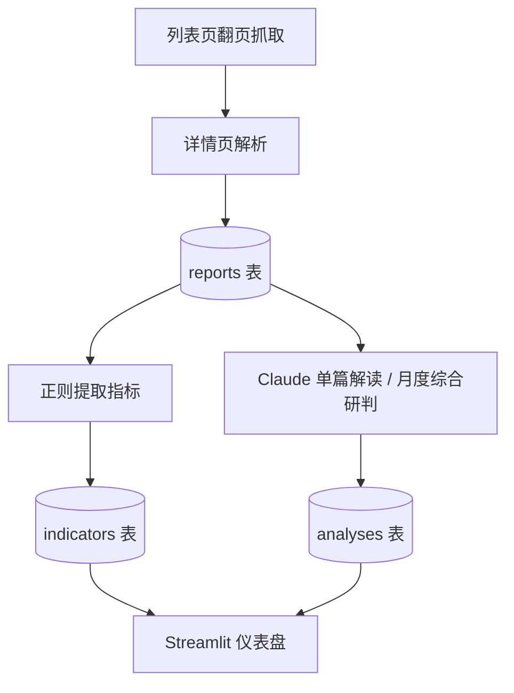

# 宏观数据解读监控（Projects-macro-monitor）

抓取**国家统计局「数据解读」**栏目（<https://www.stats.gov.cn/sj/sjjd/>）的报告，用正则提取关键指标，再调用 Claude 做**单篇解读**与**月度综合研判**，结果存入本地 SQLite，用 Streamlit 仪表盘查看。

## 流程


## 运行方式（分步，可组合）
| 步骤 | 命令 | 联网/LLM |
|---|---|---|
| 抓取新报告 | `python run.py --fetch-only` | 联网（stats.gov.cn，逐篇间隔 1.5s）|
| 提取指标 | `python run.py --extract` | 纯本地 |
| 单篇解读 | `python run.py --analyze` | 调用 Claude |
| 月度综合研判 | `python run.py --analyze-cross` | 调用 Claude |
> `--limit` 同时限制抓取与解读篇数；`--max-pages` 限制翻页（默认 20）。

## 项目结构
```
Projects-macro-monitor/
├─ scraper/     # 列表/详情抓取
├─ extractor/   # 正则指标提取
├─ analyzer/    # Claude 单篇/综合研判
├─ storage/     # SQLite 存储（data.db）
├─ dashboard/   # Streamlit 仪表盘
├─ run.py       # 入口（--fetch-only/--extract/--analyze/--analyze-cross）
├─ models.py
└─ requirements.txt
```

## 快速开始
```
git clone https://github.com/Ethan-upgrade/Projects-macro-monitor.git
cd Projects-macro-monitor
pip install -r requirements.txt
python run.py --fetch-only --max-pages 5 --limit 10
python run.py --extract
python run.py --analyze           # 需配置 Anthropic API Key
streamlit run dashboard/...
```

## 配置
需设置 Claude/Anthropic 的 API Key（环境变量）；数据来源为 stats.gov.cn。

## 许可证
见仓库。