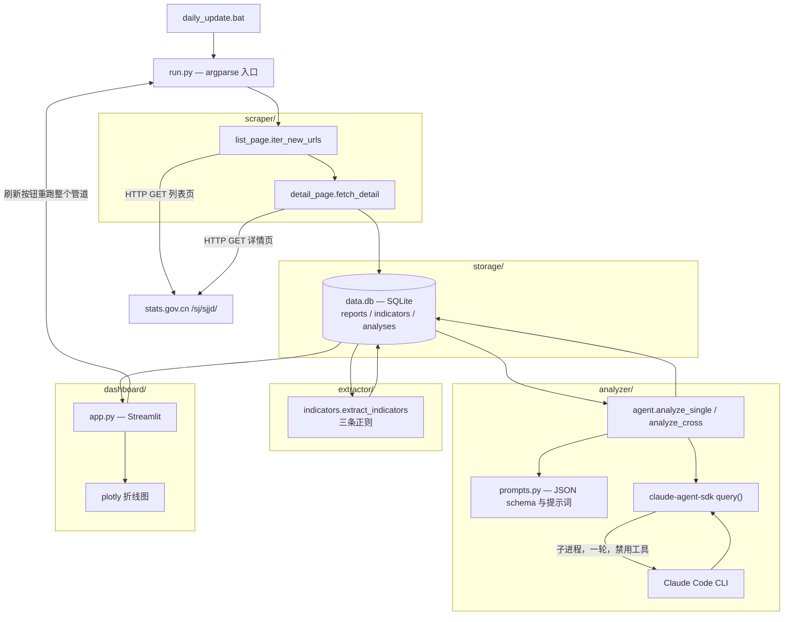
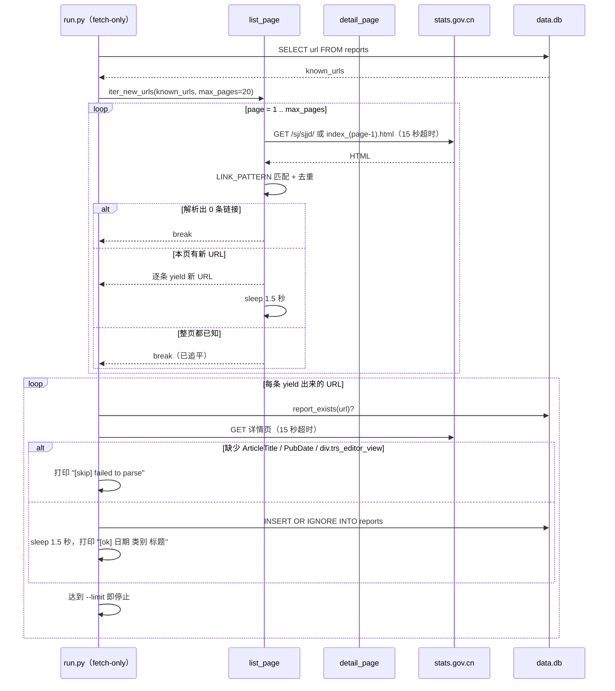
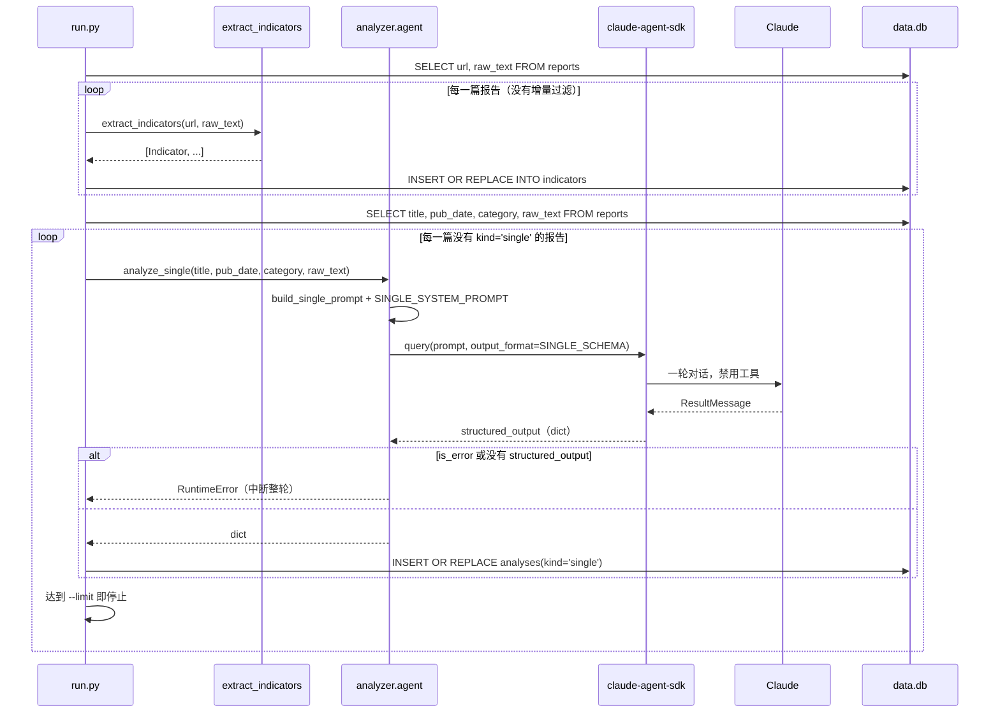
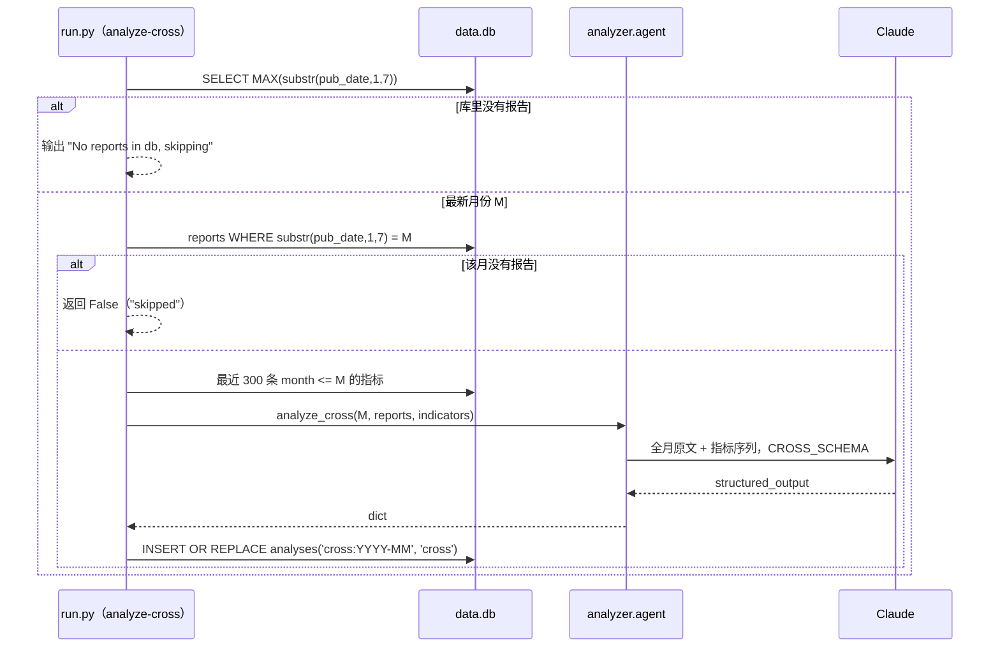
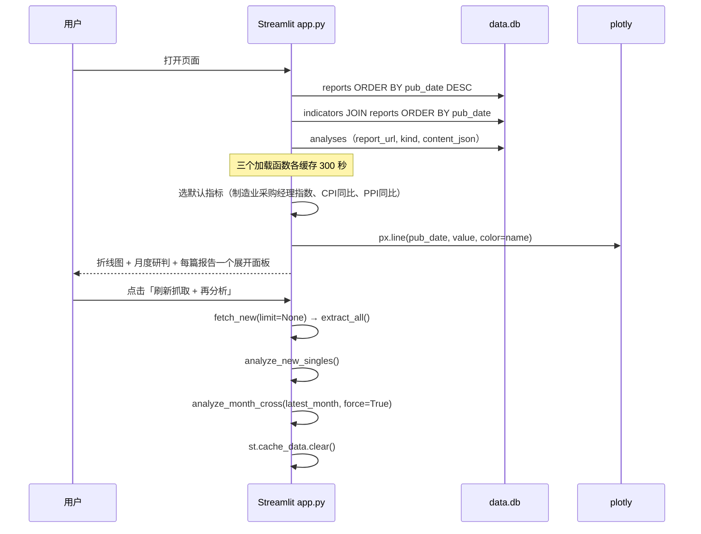
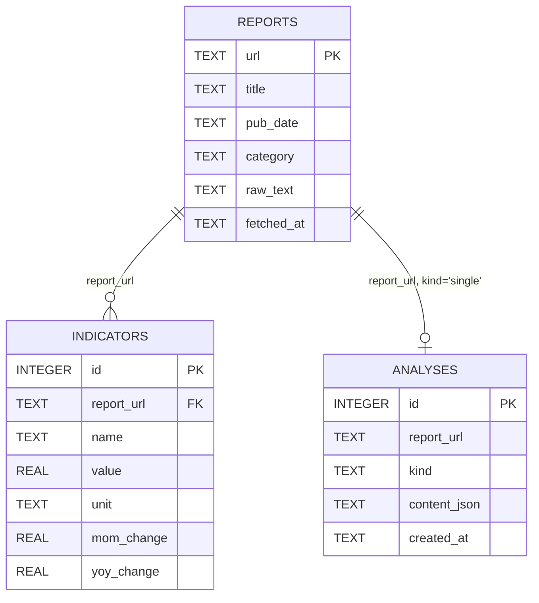
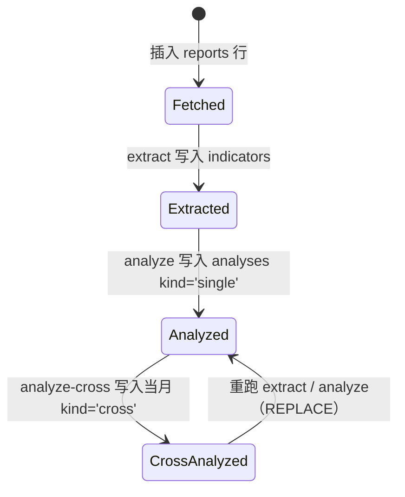

# 宏观数据解读监控（Macro Monitor）

[English](README.md) | [简体中文](README.zh-CN.md)

一个单人使用的批处理管道：抓取国家统计局「数据解读」栏目
（<https://www.stats.gov.cn/sj/sjjd/>），把每篇报告的正文存入 SQLite，用三条正则从文字里
抽出数值指标，再调用 Claude 对单篇报告做结构化提炼、对整月做跨报告综合研判。Streamlit
页面读取同一个数据库，展示指标时间序列和分析结果。

---

## 概述

国家统计局每月发布的数据解读都是长篇中文通稿——PMI、CPI/PPI、投资、社零、工业增加值等等。
本项目把这些通稿落成三张可查询的表：

| 表 | 内容 |
|---|---|
| `reports` | 每篇文章一行：URL、标题、发布日期、推测类别、正文全文 |
| `indicators` | 用正则从正文中提取的数值（值、单位、环比/同比两列） |
| `analyses` | Claude 输出的结构化 JSON，每篇报告一行（`kind='single'`）或每个月一行（`kind='cross'`） |

它面向单机上的单人分析师：没有服务端、没有鉴权、没有常驻调度进程，也没有多租户。数据库
文件被提交进仓库，所以新建克隆拿到的是现成数据快照（见下表），而不是空库。

LLM 环节不是普通的 HTTP API 调用。`analyzer/agent.py` 使用 `claude-agent-sdk`，该 SDK 以子进程
方式拉起 Claude Code CLI，并要求返回受 schema 约束的 JSON（`analyzer/agent.py:21` 的
`output_format=`）。也就是说，分析步骤要求本机已安装并登录 Claude Code CLI；Python 代码自身
不读取任何 API Key。

**仓库内快照**（`data.db`，最近一次提交时 749,568 字节）：

| 指标 | 数值 |
|---|---|
| 报告 | 60 篇，发布时间 2026-02-11 → 2026-06-30，抓取于 2026-07-03 |
| 指标 | 252 条（平均每篇约 4.2 条），`unit` 全部为 `'%'` |
| 分析 | 3 条，全部为 `kind='single'`；没有任何月度综合研判 |
| 最大类别 | `专题`（13 篇），其后是 `工业`（8）、`综合`（6）、`CPI/PPI`（6） |

---

## 目录

- [功能](#功能)
- [架构](#架构)
- [关键流程](#关键流程)
- [数据模型](#数据模型)
- [目录结构](#目录结构)
- [快速开始](#快速开始)
- [命令](#命令)
- [CLI](#cli)
- [配置](#配置)
- [定时运行](#定时运行)
- [故障排查](#故障排查)
- [设计取舍与已知限制](#设计取舍与已知限制)
- [常见问题](#常见问题)
- [许可证](#许可证)

---

## 功能

**抓取**
- 逐页遍历列表栏目，第 *n+1* 页对应 `index_{n}.html`（`scraper/list_page.py:15-18`），
  页数可配置，默认 20 页。
- 用 `^\./(\d{6})/t(\d{8})_(\d+)\.html$` 识别文章链接（`scraper/list_page.py:12`）并对锚点
  去重——列表页里每篇文章的链接会出现三次，不去重就会重复产出。
- 某一整页的链接都已存在于 `reports` 时即停止翻页（`scraper/list_page.py:50-51`）。
- 列表页之间、详情页之间各停 1.5 秒（`scraper/list_page.py:52`、`run.py:38`）；所有 HTTP
  请求超时 15 秒。
- 详情解析基于 meta 标签：`ArticleTitle`、`PubDate`（`%Y/%m/%d %H:%M`）以及
  `div.trs_editor_view` 正文，`<p>` 段落以换行拼接（`scraper/detail_page.py:54-64`）。

**分类**
- 27 条关键词映射到 17 个标签——`PMI`、`房价`、`CPI/PPI`、`CPI`、`PPI`、`投资`、`社零`、
  `工业`、`就业`、`外贸`、`民生`、`专题`、`综合`、`农业`、`能源`、`服务业`、`文化产业`——
  都不命中时落到 `其他`（`scraper/detail_page.py:11-46`）。表按「越具体越靠前」排列，
  首个命中即返回。

**指标提取** —— 三条有序正则，不涉及模型（`extractor/indicators.py`）：
1. 指数读数加环比变动（百分点），例如「制造业采购经理指数为50.3%，比上月上升0.3个百分点」
   → 数值加带符号的 `mom_change`。
2. CPI/PPI 成对句式「居民消费价格（CPI）环比上涨0.1%，同比上涨0.3%」→ 最多两行，
   名为 `CPI环比` / `CPI同比`。
3. 通用「X 同比 增长 N%」句式，覆盖总额、投资、利润、增加值、营业收入、零售额，并用
   `_clean_name` 剥掉噪音前缀。

**分析**
- 单篇 JSON：`core_conclusions`、`risk_flags`、`industry_highlights`，以及取值为
  `改善 / 走弱 / 平稳 / 分化` 的 `sentiment` 枚举（`analyzer/prompts.py:1-29`）。
- 月度综合 JSON：`overall_assessment`、`divergences`（含 `indicators_involved`）、
  `convergences`、`inflection_points`、`trend_vs_recent_3m`（`analyzer/prompts.py:31-82`）。
- 每次调用只跑一轮、禁用工具（`tools=[]`、`max_turns=1`，`analyzer/agent.py:17-22`），
  模型只能依据提示词里的文本作答。

**存储**
- SQLite 位于仓库根目录，每次连接都用 `CREATE TABLE IF NOT EXISTS` 建表，没有迁移框架
  （`storage/db.py:6-42`）。
- 幂等写入：报告用 `INSERT OR IGNORE`，指标和分析用 `INSERT OR REPLACE`，背后靠
  `(report_url, name)` 与 `(report_url, kind)` 两个唯一约束。

**仪表盘**
- 单页 Streamlit：侧边栏操作、指标折线图、月度综合研判、每篇报告一个展开面板
  （`dashboard/app.py`）。
- 查询结果缓存 300 秒，手动刷新后清空缓存（`dashboard/app.py:17,27,43,65`）。

---

## 架构



| 层 | 路径 | 职责 |
|---|---|---|
| 入口 | `run.py` | argparse 参数、四个管道步骤、月份选择 |
| 领域类型 | `models.py` | `Report`、`Indicator`、`Analysis` 三个 dataclass（无校验） |
| 抓取 | `scraper/list_page.py` | 翻页、链接正则、「已追平」判断、1.5 秒间隔 |
| 抓取 | `scraper/detail_page.py` | meta 标签解析、正文抽取、关键词分类 |
| 提取 | `extractor/indicators.py` | 三条正则、符号映射、前缀清洗、单篇内去重 |
| 提示词 | `analyzer/prompts.py` | JSON schema、中文系统提示、提示词拼装 |
| LLM 客户端 | `analyzer/agent.py` | `claude-agent-sdk` 封装、每次调用 `asyncio.run`、错误检查 |
| 存储 | `storage/db.py` | 建表、连接工厂、五个 CRUD 辅助函数 |
| 仪表盘 | `dashboard/app.py` | 四个 UI 区块、带缓存的加载函数、刷新按钮 |
| 调度 | `daily_update.bat` | 依次跑完四个步骤，追加写入 `update.log` |

没有 Web API、没有队列、没有后台 worker。每个环节都是同步函数，由 `run.py` 或 Streamlit
按钮直接调用。

---

## 关键流程

### 1. 抓取：列表页 → 详情页 → `reports`

`iter_new_urls` 自己持有一个 `httpx.Client` 并惰性产出 URL，而 `fetch_new` 另开一个 client 发
详情请求（`run.py:27`、`scraper/list_page.py:42`）。



每条插入都会立即 commit（`storage/db.py:56`），所以中途网络出错时，已经抓到的报告仍在库里。
两个抓取函数都直接调用 `raise_for_status()` 且没有 `try`，任何一次 HTTP 错误都会中断整个步骤，
而不是跳过那一篇。

### 2. 指标提取，然后单篇分析

这是两个独立命令。`--extract` 会重读**全部**报告；`--analyze` 只处理还没有 `kind='single'`
记录的报告。



每篇报告一次 `asyncio.run()`（`analyzer/agent.py:39,44`），也就是一次 SDK 会话、一次 CLI 调用。
没有任何批处理，提示词也不截断：整段 `raw_text` 原样送入，快照里就有 12,190 字的答记者问全文。

### 3. 月度跨报告综合研判



有两点需要留意：

- 综合研判行用了一个合成键 `cross:{month}`，存在 `report_url` 列里（`run.py:77`）——没有单独的
  月份表。
- `--analyze-cross` 总是传 `force=True`（`run.py:145`），仪表盘同样如此
  （`dashboard/app.py:64`），因此重跑会覆盖上个月的研判结果。`(report_url, kind)` 唯一约束
  意味着不保留历史版本。

### 4. 仪表盘读取



刷新按钮会在一次 Streamlit 请求里跑完整条管道，包括对每篇未分析报告各调一次 Claude，
所以空库首次刷新可能要跑很久。

---

## 数据模型



`analyses` **没有**外键：`report_url` 里既可能是真实 URL，也可能是合成键 `cross:YYYY-MM`；
`kind` 取 `'single'` 或 `'cross'`。

### `reports`（`storage/db.py:7-14`）

| 列 | 类型 | 说明 |
|---|---|---|
| `url` | TEXT PK | 文章绝对 URL，天然的去重键 |
| `title` | TEXT NOT NULL | 取自 `<meta name="ArticleTitle">` |
| `pub_date` | TEXT NOT NULL | `PubDate` 按 `%Y/%m/%d %H:%M` 解析后的 ISO 字符串（`scraper/detail_page.py:62`） |
| `category` | TEXT NOT NULL | 关键词表命中的 18 个标签之一 |
| `raw_text` | TEXT NOT NULL | 段落文本，换行拼接 |
| `fetched_at` | TEXT NOT NULL | 默认 `datetime('now')`，UTC |

### `indicators`（`storage/db.py:16-25`）

| 列 | 类型 | 说明 |
|---|---|---|
| `id` | INTEGER PK AUTOINCREMENT | |
| `report_url` | TEXT NOT NULL | 约定上引用 `reports(url)`；SQLite 外键强制并未开启 |
| `name` | TEXT NOT NULL | 例如 `制造业采购经理指数`、`CPI同比`、`全国规模以上工业企业利润同比` |
| `value` | REAL NOT NULL | 原文数值，符号**不**在这一列体现 |
| `unit` | TEXT NOT NULL | 恒为 `'%'`，见「设计取舍」 |
| `mom_change` | REAL NULL | 只有「百分点」那条正则会写入 |
| `yoy_change` | REAL NULL | 任何代码路径都不会写入 |
| `UNIQUE(report_url, name)` | | 同一篇报告内每个指标名只保留一条 |

### `analyses`（`storage/db.py:27-34`）

| 列 | 类型 | 说明 |
|---|---|---|
| `id` | INTEGER PK AUTOINCREMENT | |
| `report_url` | TEXT NOT NULL | 真实 URL，或 `cross:YYYY-MM` |
| `kind` | TEXT NOT NULL | `'single'` 或 `'cross'` |
| `content_json` | TEXT NOT NULL | 模型返回、经 schema 校验的 JSON |
| `created_at` | TEXT NOT NULL | 默认 `datetime('now')` |
| `UNIQUE(report_url, kind)` | | 重新分析是覆盖，不是追加 |

### 处理状态（推导得出，不落库）

库里没有状态列。一篇报告走到了哪一步，是靠其他表里有没有对应行推断的；因此下面的状态可以
回退——删掉 `analyses` 行，这篇报告就重新变成「未分析」。



### `sentiment` 枚举（`analyzer/prompts.py:21-25`）

| 取值 | 提示词中的含义 |
|---|---|
| `改善` | 景气改善 |
| `走弱` | 景气走弱 |
| `平稳` | 基本平稳 |
| `分化` | 结构分化 |

---

## 目录结构

```text
Projects-macro-monitor/
├─ run.py                     # CLI 入口：fetch / extract / analyze / analyze-cross
├─ models.py                  # Report、Indicator、Analysis 三个 dataclass
├─ requirements.txt           # 7 个依赖，均未锁版本
├─ daily_update.bat           # Windows 定时脚本：四个步骤全跑，追加写 update.log
├─ data.db                    # 提交进仓库的 SQLite 快照（60 篇报告 / 252 条指标）
├─ scraper/
│  ├─ __init__.py             # 空包标记
│  ├─ list_page.py            # 翻页、链接正则、追平判断、1.5 秒间隔
│  └─ detail_page.py          # meta 标签解析、正文抽取、关键词分类
├─ extractor/
│  ├─ __init__.py
│  └─ indicators.py           # 三条正则、符号映射、噪音前缀清洗
├─ analyzer/
│  ├─ __init__.py
│  ├─ agent.py                # claude-agent-sdk 封装 + 一个 __main__ 演示
│  └─ prompts.py              # SINGLE/CROSS 的 JSON schema 与中文提示词
├─ storage/
│  ├─ __init__.py
│  └─ db.py                   # 建表 DDL、连接工厂、CRUD 辅助函数
├─ dashboard/
│  └─ app.py                  # 唯一的 Streamlit 页面（四个区块，无子页面）
├─ .gitignore                 # pycache、venv、日志、.env
└─ README.md / README.zh-CN.md
```

`dashboard/` 下没有 `__init__.py`，它是被当作脚本启动的，不是作为包导入的。

---

## 快速开始

要求：

- **Python 3.10+** —— `run.py` 与 `models.py` 用了 `int | None` / `float | None` 注解，
  导入时即求值。
- 抓取步骤需要能访问 `www.stats.gov.cn`。
- `--analyze` 与 `--analyze-cross` 需要**已安装并登录的 Claude Code CLI**，因为
  `claude-agent-sdk` 是以子进程方式驱动 CLI 的。先按 `requirements.txt` 装 Python 包，
  CLI 是另一个独立前提。

```bash
# 1. 克隆并进入
git clone https://github.com/Ethan-upgrade/Projects-macro-monitor.git
cd Projects-macro-monitor

# 2. 隔离环境（依赖没锁版本，别用系统 Python）
python -m venv .venv
# Windows
.venv\Scripts\activate
# macOS/Linux
source .venv/bin/activate

# 3. 安装
pip install -r requirements.txt

# 4. 有界首次抓取（5 个列表页，新增满 10 篇即停）
python run.py --fetch-only --max-pages 5 --limit 10

# 5. 对库里所有报告提取指标
python run.py --extract

# 6. LLM 步骤 —— 需要 Claude Code CLI
python run.py --analyze
python run.py --analyze-cross

# 7. 仪表盘（http://localhost:8501）
streamlit run dashboard/app.py
```

新建的克隆里 `data.db` 已有 60 篇报告，所以第 4、5 步可以跳过，直接开仪表盘看快照。

分步组合就是设计上的用法——每个开关都独立，可以单独跑。不带任何参数运行 `python run.py`
只会解析参数，什么也不做。

---

## 命令

| 命令 | 作用 |
|---|---|
| `python run.py --fetch-only` | 抓取新文章写入 `reports`（最多 20 个列表页） |
| `python run.py --fetch-only --max-pages 5 --limit 10` | 同上，但页数和新报告数都受限 |
| `python run.py --extract` | 对库内每篇报告重跑指标提取 |
| `python run.py --analyze` | 对没有 `single` 记录的报告做单篇分析 |
| `python run.py --analyze-cross` | 对最新月份做综合研判，且总是强制重算 |
| `python -m analyzer.agent` | 临时用：只分析最新一篇报告并打印 JSON |
| `streamlit run dashboard/app.py` | 启动仪表盘（Streamlit 默认 8501 端口） |
| `daily_update.bat` | 依次跑 抓取（5 页）→ 提取 → 单篇分析 → 综合研判，日志写入 `update.log` |
| `cat requirements.txt` | 七个依赖：`claude-agent-sdk`、`httpx`、`beautifulsoup4`、`lxml`、`streamlit`、`plotly`、`pandas` |

仓库里没有测试运行器、没有 lint 配置、没有构建步骤。

---

## CLI

`run.py` 一共六个参数（`run.py:119-126`）。除两个整数外都是布尔开关；同时给出时按
抓取 → 提取 → 分析 → 综合研判的固定顺序执行（`run.py:128-146`）。

| 参数 | 类型 | 默认值 | 作用 |
|---|---|---|---|
| `--fetch-only` | 开关 | 关 | 遍历列表页，插入新报告 |
| `--extract` | 开关 | 关 | 对**全部**报告跑正则，写入/覆盖指标 |
| `--analyze` | 开关 | 关 | 对未分析报告做 Claude 单篇分析 |
| `--analyze-cross` | 开关 | 关 | 对 `MAX(pub_date)` 所在月份做综合研判，`force=True` |
| `--limit` | int | `None` | 同时限制抓取篇数与分析篇数。对 `--extract` 无效，也不限制综合研判 |
| `--max-pages` | int | `20` | 单次抓取最多翻多少页 |

代码里体现的细节：

- `--limit` 在两个步骤里含义不同：`fetch_new` 数的是成功插入的报告数（`run.py:37-40`），
  `analyze_new_singles` 数的是产出的分析条数（`run.py:68-70`）。
- `--analyze-cross` 完全忽略 `--limit`，它固定只处理一个月。
- `--max-pages` 用尽时没有任何提示：`iter_new_urls` 到上限就停，`fetch_new` 只打印抓到的数量，
  不会告诉你「后面还有」。

---

## 配置

代码**不读取任何环境变量**。所有本可以做成配置项的东西，都是模块常量或函数默认值，想改行为
就得改代码。

| 名称 | 取值 | 出处 | 含义 |
|---|---|---|---|
| `DB_PATH` | `<repo>/data.db` | `storage/db.py:4` | SQLite 位置，由 `__file__` 推导，无法覆盖 |
| `BASE_URL` | `https://www.stats.gov.cn/sj/sjjd/` | `scraper/list_page.py:8` | 列表栏目根地址 |
| `REQUEST_DELAY_SECONDS` | `1.5` | `scraper/list_page.py:10` | 只作用于列表页之间的间隔 |
| 详情页间隔 | `1.5`（字面量） | `run.py:38` | 每成功插入一篇后的等待；没有复用上面的常量 |
| HTTP 超时 | `15` 秒 | `scraper/list_page.py:23`、`scraper/detail_page.py:50` | 单请求超时 |
| `HEADERS` | UA `Mozilla/5.0 (Windows NT 10.0; Win64; x64) macro-monitor-bot/0.1` | `scraper/detail_page.py:8`（`scraper/list_page.py:9` 另有一份） | 所有请求都带上 |
| `LINK_PATTERN` | `^\./(\d{6})/t(\d{8})_(\d+)\.html$` | `scraper/list_page.py:12` | 文章链接的相对路径形态 |
| `max_pages` | `20` | `run.py:22` | 默认页数上限 |
| 指标历史 | `LIMIT 300` | `run.py:100` | 传给综合研判的指标条数 |
| 仪表盘缓存 | `ttl=300` 秒 | `dashboard/app.py:17,27,43` | Streamlit 缓存时长 |
| `PYTHON` | `python` | `daily_update.bat:3` | 定时脚本使用的解释器 |

外部提供、但本仓库代码不读取的：

| 变量 | 消费方 | 为什么重要 |
|---|---|---|
| `ANTHROPIC_API_KEY`（或 Claude Code 登录态） | 由 `claude-agent-sdk` 拉起的 Claude Code CLI | 没有它，`--analyze` / `--analyze-cross` 会在 SDK 内部失败 |

---

## 定时运行

`daily_update.bat` 是唯一的自动化入口（`daily_update.bat:1-7`）：

```bat
@echo off
cd /d "%~dp0"
if not defined PYTHON set PYTHON=python
"%PYTHON%" run.py --fetch-only --max-pages 5 >> update.log 2>&1
"%PYTHON%" run.py --extract >> update.log 2>&1
"%PYTHON%" run.py --analyze >> update.log 2>&1
"%PYTHON%" run.py --analyze-cross >> update.log 2>&1
```

它按顺序跑四个步骤，日志追加到 `update.log`（已被 git 忽略），并且失败不停：某一步出错，下一步
照跑。脚本内部没有 cron / 任务计划注册、没有重试、也不检查退出码；挂到系统定时任务上需要自己
配置。

---

## 故障排查

| 现象 | 原因 | 处理 |
|---|---|---|
| `ModuleNotFoundError: claude_agent_sdk`（或 `httpx`、`bs4` 等） | 依赖没装；`requirements.txt` 未锁版本，全局环境里可能缺失 | 在 venv 里 `pip install -r requirements.txt` |
| `RuntimeError: no ResultMessage received from claude-agent-sdk query` | SDK 没拿到结果，通常是 CLI 未安装、未登录或版本不匹配 | 在终端里先手动跑一次 `claude` 完成登录后再试 |
| `RuntimeError: claude-agent-sdk query failed: ...` | CLI 返回了错误结果（鉴权、额度、模型权限） | 消息里的 `subtype` / `errors` 会说明原因，按提示修鉴权或额度 |
| `RuntimeError: no structured_output in result` | 模型用散文回答，没按 JSON schema 输出 | 重试；若持续出现，需要检查 SDK 与 schema 的组合 |
| `[skip] failed to parse <url>` | 页面里缺 `ArticleTitle`、`PubDate` 或 `div.trs_editor_view` | 站点结构变了，改 `scraper/detail_page.py:54-62` 的选择器 |
| 抓取返回 0 篇新报告 | 要么确实已追平，要么列表页改版导致 `LINK_PATTERN` 一条都不匹配 | 打开列表页，拿 href 对照 `scraper/list_page.py:12` |
| 老报告一直抓不到 | `iter_new_urls` 遇到「本页零新增」就停，中途插入到旧页面的文章会被跳过 | 调大 `--max-pages`；或按站点归档补齐这段缺口 |
| 抓取以 `httpx.HTTPStatusError` 中断 | 两个抓取函数都没有保护 `raise_for_status()` | 重跑即可；已 commit 的报告不会丢（逐行提交） |
| 仪表盘显示「尚无综合研判」 | 最新月份没有 `kind='cross'` 记录（快照里就没有） | 点「刷新抓取 + 再分析」，或运行 `python run.py --analyze-cross` |
| 仪表盘折线图是空的 | `indicators` 为空——这个库还没跑过 `--extract` | `python run.py --extract` |
| `st.plotly_chart(..., width="stretch")` 抛 `TypeError` | Streamlit 早于引入 `width` 参数的版本，而依赖未锁版本 | `pip install -U streamlit` |
| 刷新按钮像卡住了 | 它在一次请求里跑抓取 + 提取 + 每篇未分析报告各一次 Claude 调用 | 改用 CLI 分步跑，或先用 `--limit` 预分析 |
| `--analyze-cross` 每次都花一次调用 | `force=True` 是写死的（`run.py:145`、`dashboard/app.py:64`） | 属于预期行为；上个月的记录会被覆盖 |
| `update.log` 越来越大 | 批处理只追加，从不轮转 | 手动删除或清空 |
| 报告类别一直是 `其他` | 标题没命中 `CATEGORY_KEYWORDS` 里的任何词 | 在 `scraper/detail_page.py:11-39` 补一对关键词 |

---

## 设计取舍与已知限制

- **用正则而不是模型提取。** 确定、免费、快，但召回受限于三种句式。快照里 60 篇报告只有 252
  条指标——平均每篇约 4 条，远低于这些文章里数字的实际数量。写成「提高了 0.3 个百分点」、
  只写「环比持平」不给数值、或者以亿元为单位的绝对水平，都会被丢掉。
- **`yoy_change` 是死列。** 没有任何代码路径写它：252 行全部是 `NULL`。`mom_change` 也只有
  「百分点」那条正则会填，252 行里有 210 行是 `NULL`。其余两种句式把符号直接乘进了 `value`
  （`extractor/indicators.py:75,83`），所以 `CPI同比` 为 `-0.1` 表示通缩，而 PMI 的 `50.3`
  只是指数水平。
- **`unit` 恒为 `'%'`。** PMI 这类指数并不是百分比，而是围绕 50 的扩散指数。这一列没有信息
  量；判断是不是指数序列要看指标名，别看单位。
- **「近 3 个月」只是提示词里的说法，不是查询条件。** `CROSS_SYSTEM_PROMPT` 要求模型与近三个
  月对比，但 SQL 取的是截至目标月份最新 300 条指标，没有任何时间窗口（`run.py:97-101`），
  哪些算「近期」由模型自己判断。
- **综合研判用字符串作键。** `cross:YYYY-MM` 存在 `report_url` 里，因此没有月份维度、没有历史，
  也无法同时保留同一个月的两版结果（`UNIQUE(report_url, kind)` 加 `force=True` 保证每月只有
  一行）。
- **错误处理是快速失败。** 没有重试、没有退避、也没有逐篇 `try`。一次 HTTP 500 或一次模型
  异常就会中断整个步骤。逐行提交让已完成的工作不会丢，但必须人工重启。
- **提取不是增量的。** `--extract` 会重扫每篇报告并 `INSERT OR REPLACE` 指标。改正则时很方便，
  但成本随库增长线性上升，而且 `insert_indicator` 是逐行 commit。
- **改表结构只能手工。** 每次连接都执行 `CREATE TABLE IF NOT EXISTS`，没有迁移、除了两个唯一
  约束没有其他索引。`indicators` 上也没有 `report_url` 索引，所以仪表盘的 join 是全表扫描。
- **`data.db` 被提交进仓库。** 这个仓库一半是数据快照（60 篇、约 750 KB）。每个克隆都从旧数据
  起步，而每次 `--fetch-only` 都会重写该文件，在 git 里产生嘈杂的二进制 diff。
- **页数上限截断是静默的。** 翻页超过 `--max-pages` 不会有任何提示，运行看起来成功，实际可能
  还缺好几个月。
- **单机单人。** 没有鉴权、没有 API、除了两处 1.5 秒等待没有别的限速，也不处理 robots.txt。
  它发送机器人风格的 User-Agent，除了固定间隔之外没有更多礼让措施。
- **没有测试、没有 CI、没有许可证。** 仓库里没有测试套件、没有 GitHub Actions 工作流、也没有
  `LICENSE` 文件，尽管上一版 README 写的是「见仓库」。
- **工具链偏 Windows。** `daily_update.bat` 是批处理；Python 本身是跨平台的。

---

## 常见问题

**这个仓库会直接调用 Anthropic 的 HTTP API 吗？** 不会。`analyzer/agent.py` 调用的是
`claude-agent-sdk`，该 SDK 以子进程方式运行 Claude Code CLI。CLI 用什么凭据——API Key 还是
订阅登录——分析步骤就用什么。Python 侧从不碰 `ANTHROPIC_API_KEY`。

**用的是哪个模型？** 代码没有指定。`ClaudeAgentOptions` 只设了 `system_prompt`、`tools=[]`、
`max_turns=1` 和 `output_format`（`analyzer/agent.py:17-22`），模型由 CLI 的配置决定。

**能通过配置把数据库挪走吗？** 不能。`DB_PATH` 由 `storage/db.py` 自身位置推导
（`storage/db.py:4`）。挪文件就必须改那一行。

**为什么有的报告有指标却没有分析？** `--extract` 和 `--analyze` 相互独立。仓库里的快照就是
60 篇报告、252 条指标，但只有 3 条 `single` 分析。

**`sentiment` 为什么是中文？** 整个提示词层都是中文——系统提示、字段描述、枚举值都一样
（`analyzer/prompts.py:23`）。模型也用中文回复，仪表盘原样展示。

**改了提示词之后能重建分析吗？** 能，但没有现成开关：代码对 `analysis_exists(...)` 为真的行
直接跳过（`run.py:63`）。要么删掉对应的 `analyses` 行，要么直接对 `data.db` 写一句 SQL。

**`--fetch-only` 会漏文章吗？** 会。它遇到「整页没有未知 URL」就停，所以后补进旧页面的文章
看不见（`scraper/list_page.py:50-51`）。目前每个列表页有 15 篇不重复文章，`--max-pages 20`
大致覆盖 300 条。

**抓取对数据源礼貌吗？** 它带了一个说明用途的 User-Agent，并固定 1.5 秒间隔，但没有并发控制、
没有重试策略、也不检查 robots.txt。这是个个人规模的工具。

---

## 许可证

仓库里没有许可证文件（`gh` 也查不到 license 元数据）。除非作者另行声明，否则视为保留所有权利。
