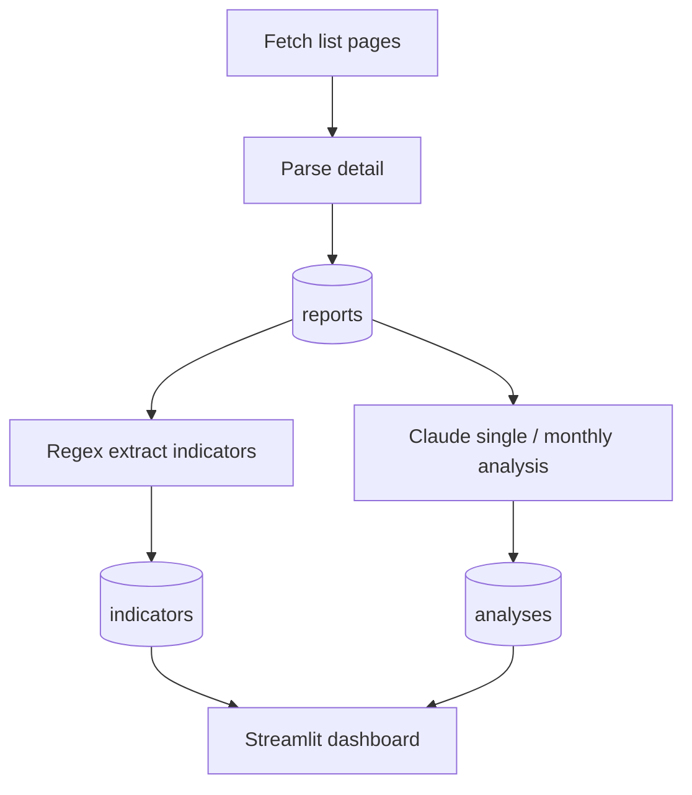

# Projects-macro-monitor — Macro Report Monitoring

Scrapes reports from the **National Bureau of Statistics "Data Interpretation"** column (<https://www.stats.gov.cn/sj/sjjd/>), extracts key indicators via regex, then calls Claude for **single-report interpretation** and **monthly cross-report analysis**; results are stored in local SQLite and viewed via a Streamlit dashboard.

## Workflow


## Run Steps (composable)
| Step | Command | Network/LLM |
|---|---|---|
| Fetch new reports | `python run.py --fetch-only` | network (stats.gov.cn, 1.5s apart) |
| Extract indicators | `python run.py --extract` | local only |
| Single analysis | `python run.py --analyze` | Claude |
| Monthly cross analysis | `python run.py --analyze-cross` | Claude |
> `--limit` caps fetch/analysis count; `--max-pages` caps pagination (default 20).

## Project Structure
```
Projects-macro-monitor/
├─ scraper/     # list/detail scraping
├─ extractor/   # regex indicator extraction
├─ analyzer/    # Claude single/cross analysis
├─ storage/     # SQLite (data.db)
├─ dashboard/   # Streamlit dashboard
├─ run.py       # entry (--fetch-only/--extract/--analyze/--analyze-cross)
├─ models.py
└─ requirements.txt
```

## Getting Started
```
git clone https://github.com/Ethan-upgrade/Projects-macro-monitor.git
cd Projects-macro-monitor
pip install -r requirements.txt
python run.py --fetch-only --max-pages 5 --limit 10
python run.py --extract
python run.py --analyze           # needs Anthropic API key
streamlit run dashboard/...
```

## Configuration
Set the Claude/Anthropic API key (env); data source is stats.gov.cn.

## License
See the repository.